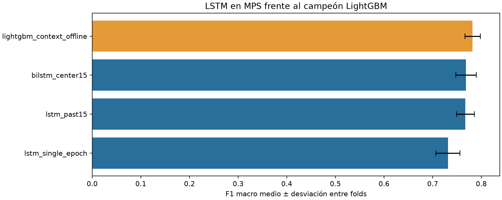
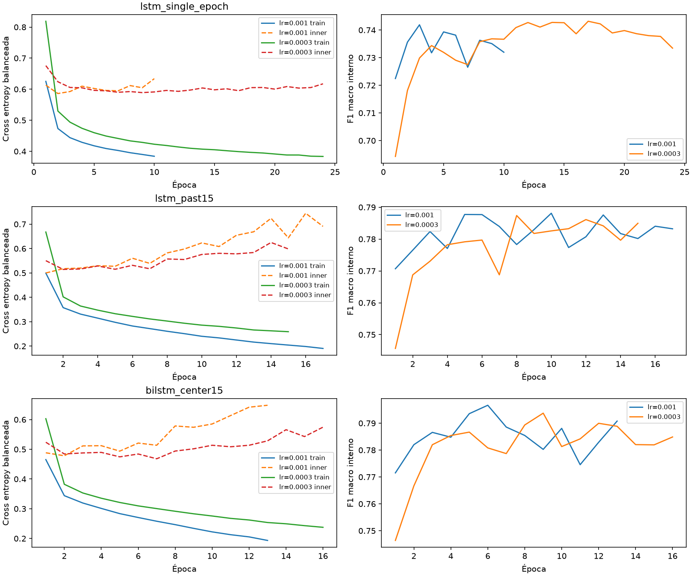
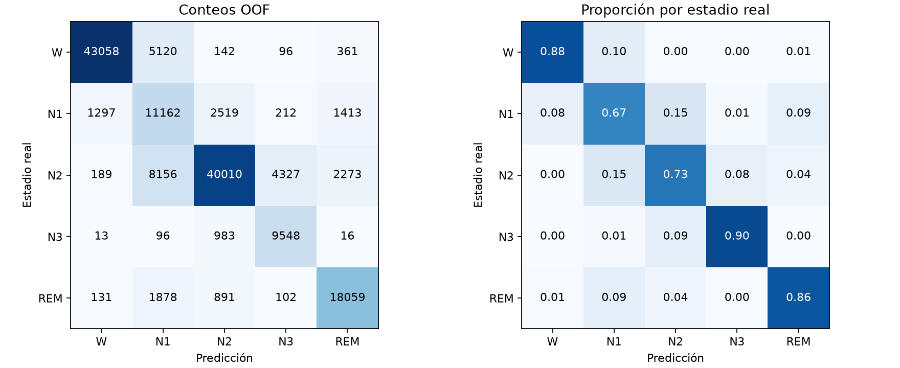

# LSTM y BiLSTM en MPS: comparación con el campeón

Campaña ejecutada el 17 de noviembre de 2026. Notebook: [05_lstm_mps.ipynb](../notebooks/05_lstm_mps.ipynb). Protocolo: [plan de experimentación](../plans/20261117-1856-lstm-mps-sleep-edfx.md).

**LightGBM conserva el mejor F1 macro de desarrollo.** La mejor red fue la BiLSTM centrada, con **0,7687 ± 0,0211**, frente a **0,7822 ± 0,0161** del campeón. La diferencia media entre folds fue de **−0,0135**, aproximadamente −1,35 puntos. El resultado no justifica sustituir el candidato actual.

## Datos, entradas y validación

Se utilizaron los mismos 62 sujetos, 122 registros y 152.052 segmentos supervisados de 30 segundos de la campaña anterior, con cinco folds congelados por sujeto. Todas las noches de un sujeto permanecieron juntas. Los 16 sujetos de test se mantuvieron excluidos.

Las redes recibieron 145 variables por segmento de EEG Fpz-Cz, EEG Pz-Oz, EOG y envolvente EMG. Las ventanas se construyeron sobre las 152.167 filas disponibles, conservando señales de M como contexto sin introducir sus etiquetas; los objetivos fueron las mismas 152.052 filas con target de cinco clases. Las ventanas se reiniciaron en registros y discontinuidades, con replicación de extremos dentro del mismo bloque.

La normalización utilizó mediana y percentiles 5/95 calculados únicamente con sujetos de entrenamiento, escala `(p95-p5)/3,29`, suelo de `1e-6` y clipping a [−10, 10]. El escalador se volvió a ajustar en cada refit externo. LightGBM utiliza 435 variables, incluidas versiones temporales normalizadas por noche: se comparan soluciones completas sobre los mismos objetivos, no arquitecturas con entradas idénticas.

Dentro de cada entrenamiento externo se reservó el 20 % de sus sujetos para seleccionar learning rate y número de épocas. El fold externo se predijo después de reentrenar desde cero sobre todo su entrenamiento, sin usar sus etiquetas para early stopping.

## Arquitecturas y entrenamiento

| Variante | Ventana | Objetivo | Unidades y dirección |
| --- | --- | --- | --- |
| `lstm_single_epoch` | Un segmento | Segmento único | LSTM de 64 unidades, una dirección |
| `lstm_past15` | 14 segmentos anteriores y el actual | Último segmento | LSTM de 64 unidades, una dirección |
| `bilstm_center15` | Siete anteriores, actual y siete posteriores | Segmento central | LSTM de 64 unidades por dirección |

Todas usan proyección 145→64 con ReLU, una capa recurrente, dropout 0,3 en el head y salida de cinco logits. El estado recurrente se reinicia entre ventanas. En la BiLSTM se usa la salida del segmento central, con ambas direcciones.

La pérdida fue CrossEntropy con pesos inversos de frecuencia de entrenamiento. Se compararon learning rates 0,001 y 0,0003 con AdamW, weight decay 0,0001, clipping de gradiente a norma 1 y batch 256. Se permitieron hasta 50 épocas; early stopping por F1 macro interno, paciencia 7 y mejora mínima 0,0001. No se utilizó scheduler.

Se completaron **48 entrenamientos científicos**: 30 candidatos internos y 15 refits externos para las tres comparaciones, más dos candidatos internos y un refit final del mejor modelo neuronal. En total se ejecutaron 611 épocas de optimización en estos entrenamientos. Las comprobaciones técnicas se conservaron por separado.

PyTorch 2.14.1 ejecutó forward, backward y predicción en **MPS**, con float32 y fallback CPU deshabilitado. Lectura, normalización, métricas y escritura de artefactos utilizaron CPU. El benchmark de una época sobre 95.484 segmentos de entrenamiento interno midió 1,2–1,4 segundos por variante, incluyendo validación y excluyendo parte del coste de persistencia; no representa el tiempo total de la campaña.

## Resultados

| Modelo | F1 macro CV | Desviación entre folds | Accuracy CV | Kappa CV |
| --- | ---: | ---: | ---: | ---: |
| LightGBM · contexto, campeón | **0,7822** | 0,0161 | **0,8167** | **0,7539** |
| BiLSTM · 15 segmentos centrados | 0,7687 | 0,0211 | 0,8007 | 0,7351 |
| LSTM · 15 segmentos pasados | 0,7673 | 0,0184 | 0,8049 | 0,7388 |
| LSTM · un segmento | 0,7313 | 0,0250 | 0,7647 | 0,6887 |

La LSTM con pasado mejoró al control de un segmento en 0,0359 de F1 macro; la BiLSTM lo mejoró en 0,0373. El contexto aprendido aporta valor dentro de esta familia, pero las configuraciones probadas no superaron al campeón. La diferencia entre BiLSTM y LSTM pasada fue pequeña, 0,0014, y cambia tanto la dirección como la posición del objetivo; no se interpreta como evidencia aislada del efecto de bidireccionalidad.

Los valores son promedios de cinco folds. Su desviación no es un intervalo de confianza y no se pondera por el número de segmentos del fold.

## Selección de épocas y generalización

| Modelo | Épocas elegidas para el refit en folds 0–4 |
| --- | --- |
| LSTM · un segmento | 17, 4, 5, 22, 16 |
| LSTM · pasado | 10, 15, 4, 12, 5 |
| BiLSTM · centrada | 6, 6, 4, 6, 5 |

En las curvas internas del fold 0, la pérdida de entrenamiento continuó bajando mientras la pérdida de validación dejó de mejorar. Es un patrón compatible con sobreajuste; aumentar el número de épocas no produjo una mejora interna sostenida. El checkpoint se seleccionó por F1 macro, no por la pérdida ni por los resultados externos.

## Resultados por estadio e incertidumbre

| Estadio | LightGBM · F1 OOF | BiLSTM · F1 OOF |
| --- | ---: | ---: |
| W | 0,9181 | 0,9214 |
| N1 | 0,5234 | 0,5190 |
| N2 | 0,8294 | 0,8042 |
| N3 | 0,7915 | 0,7656 |
| REM | 0,8528 | 0,8364 |

La BiLSTM obtuvo un F1 de vigilia ligeramente mayor. Sus pérdidas principales frente al campeón aparecieron en N2, N3 y REM. Para N1 aumentó el recall, de 0,6260 a 0,6723, pero disminuyó la precisión, de 0,4497 a 0,4226; el F1 resultante quedó ligeramente por debajo del de LightGBM. La matriz muestra, entre otras confusiones, 8.156 segmentos N2 clasificados como N1.

Con 2.000 remuestreos emparejados de sujetos completos, la diferencia de F1 macro OOF agrupado de BiLSTM menos LightGBM fue **−0,0137**, IC del 95 % **[−0,0226, −0,0049]**. Para LSTM pasada fue −0,0144, IC [−0,0231, −0,0060]. Esta agregación OOF es diferente del promedio por fold de la tabla principal.

Los intervalos son condicionales a las predicciones de los modelos OOF ya entrenados; no cubren toda la variabilidad del reentrenamiento ni sustituyen el test reservado. La elección entre variantes conserva un carácter exploratorio.

## MLflow y candidato neuronal

- Experimento: `sleep-cassette-lstm-mps-v1` en el MLflow local (`http://127.0.0.1:5002/#/experiments/2`), en el tracking local existente.
- Campaña: `cec1b268c47cf3922935`; run padre `0b66f79bb9c24dbfa20ab038d80bcbd9`.
- El experimento contiene 73 runs: 68 para organizar la campaña científica y sus 48 entrenamientos, y cinco para preflight/benchmark. Todas las corridas científicas terminaron correctamente.
- Cada entrenamiento conserva configuración, sujetos, escalador, pesos de clase, curvas, estados RNG, optimizador y checkpoints. Se guardaron probabilidades OOF para los mismos 152.052 objetivos de cada modelo.
- El candidato BiLSTM final se seleccionó con otro holdout interno de desarrollo: learning rate 0,0003 y seis épocas. Se reentrenó con los 62 sujetos y se guardó bajo `var/research/sc-w30-lstm-mps-v1/runs/cec1b268c47cf3922935/candidate/`.
- Run del candidato: `00c9b7de59b44b9da6962f7ad657df3e`; SHA-256 de `refit/model.pt`: `c83aac447037a3b506b0e1c1120b158c0061ac50d194d4069d279dbbf2a444ba`.
- El checkpoint incluye `state_dict`, arquitectura, clases, columnas y escalador. `candidate.json` y `example.npz` documentan el contrato `[batch, 15, 145]` de ventanas ya escaladas. No es una entrada intercambiable con `predict_features` ni una interfaz directa para EDF nuevos.
- El alias `models:/sleep_sc_task5_literature_v2@candidate` conserva la versión 1 de LightGBM. No se promovió un modelo neuronal al registro.

## Verificaciones y siguientes pruebas

Una auditoría independiente recalculó métricas desde las OOF, verificó los 15 folds y los 48 entrenamientos, comparó los valores de cada escalador con sus sujetos de entrenamiento y comprobó hashes de datos y modelos. El candidato archivado en MLflow se descargó, verificó y recargó en MPS, conservando sus predicciones y probabilidades normalizadas. Los resultados están en `validation.json` y la auditoría se conserva como artefacto del run padre.

Repetir el runner reutilizó la campaña terminada: **73 runs antes y después**, sin reentrenar y con el mismo contenido de `campaign.json`. El notebook se ejecutó con siete celdas de código, tres figuras y cero errores.

La suite completa aprobó **59 pruebas**, sin omisiones, incluidas las pruebas de entrenamiento real en MPS, posición del objetivo, independencia entre ventanas, recarga y reanudación tras una interrupción deliberada. Ruff y mypy pasaron; se verificó el formato de los siete archivos Python nuevos. Los dos warnings proceden de una deprecación de MLflow/SQLAlchemy y de una clase escasa en el piloto histórico.

La siguiente prueba con mayor interés sería aislar el efecto de la representación y la normalización: comparar la LSTM con las variables de contexto ya disponibles y con una normalización retrospectiva compatible, como otra campaña explícita. Después pueden estudiarse capacidad y regularización. El recorte dependiente de anotaciones y la validación final sobre los 16 sujetos siguen pendientes. **El campeón vigente continúa siendo LightGBM.**
