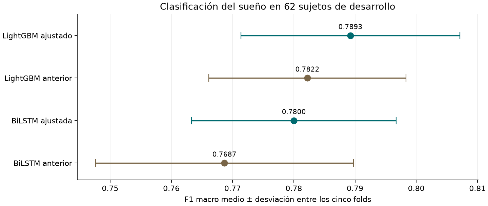
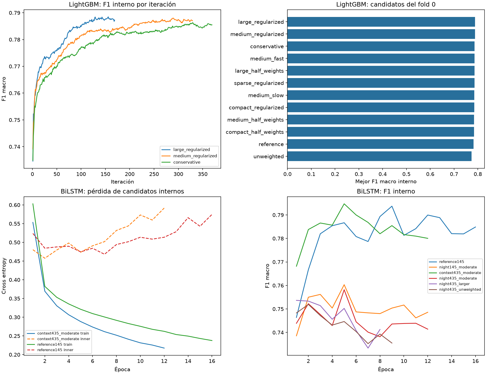
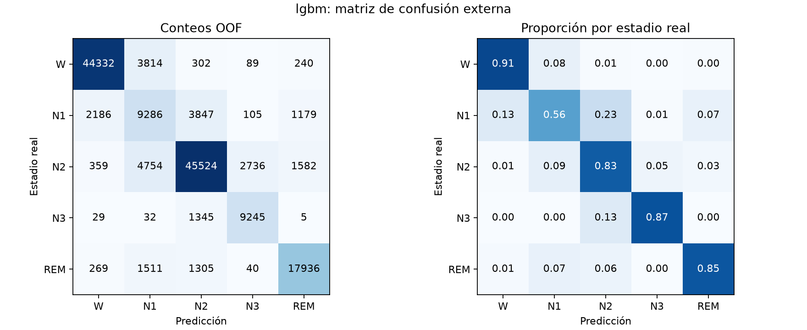

# Ajuste de LightGBM y BiLSTM en Sleep Cassette

LightGBM ajustado obtuvo el mayor F1 macro en desarrollo, **0,7893**. Frente a su referencia, LightGBM pasó de 0,7822 a 0,7893 y BiLSTM de 0,7687 a 0,7800. La comparación usa cinco folds fijos por sujeto. Los 16 sujetos del test siguen reservados para evaluar el candidato que se congele.

| Modelo | F1 macro medio ± DE | Exactitud media | Kappa medio |
| --- | --- | --- | --- |
| LightGBM ajustado | 0,7893 ± 0,0179 | 0,8300 | 0,7691 |
| LightGBM anterior | 0,7822 ± 0,0161 | 0,8167 | 0,7539 |
| BiLSTM ajustada | 0,7800 ± 0,0167 | 0,8187 | 0,7551 |
| BiLSTM anterior | 0,7687 ± 0,0211 | 0,8007 | 0,7351 |



## Selección y entrenamiento

La cohorte contiene 62 sujetos, 122 registros y 152.052 épocas etiquetadas de 30 segundos. Otras 115 épocas permanecen disponibles como contexto. Las dos noches de una persona pertenecen siempre al mismo fold. Dentro de cada entrenamiento externo reservamos el 20 % de los sujetos para seleccionar la configuración y el número de iteraciones por F1 macro. Después reentrenamos con todos los sujetos de ese entrenamiento y evaluamos una vez su fold externo.

LightGBM probó 12 configuraciones sobre las 435 variables del campeón. Variamos el número de hojas (15, 31 o 63), muestras por hoja, bins, tasa de aprendizaje, regularización L1/L2, muestreo de filas y columnas y ponderación por clase. Usamos parada temprana sobre F1 macro interno con paciencia de 40 iteraciones y mejora mínima de 0,0001. Con cinco clases, cada iteración de boosting construye cinco árboles. La imputación, el escalado y los pesos de clase se ajustaron con los ejemplos de entrenamiento.

BiLSTM probó seis configuraciones en MPS con precisión float32. Las ventanas centradas abarcan 15 segmentos y se reinician en límites de registro o huecos. La red proyecta cada entrada, usa una capa recurrente bidireccional y clasifica el segmento central. Probamos 145 o 435 variables, normalización adicional por noche, 64 o 128 unidades por dirección, distintas tasas de aprendizaje, dropout y ponderación de clases. Usamos AdamW, lotes de 256, máximo de 50 épocas, paciencia de siete épocas y clipping de gradiente a 1. Los espacios completos están en el [archivo de configuración](../configs/research/refinement.yaml).

| Fold | LightGBM elegido | Iteraciones | F1 externo | BiLSTM elegida | Épocas | F1 externo |
| --- | --- | --- | --- | --- | --- | --- |
| 0 | large_regularized | 129 | 0,7546 | context435_moderate | 5 | 0,7477 |
| 1 | large_regularized | 280 | 0,7976 | context435_moderate | 3 | 0,7956 |
| 2 | large_regularized | 287 | 0,7992 | context435_moderate | 1 | 0,7883 |
| 3 | large_regularized | 409 | 0,8042 | context435_moderate | 9 | 0,7827 |
| 4 | large_half_weights | 118 | 0,7906 | context435_moderate | 7 | 0,7857 |

El aumento de 145 a 435 variables añade a cada descriptor la media de los cuatro segmentos anteriores y una media triangular centrada de 15 segmentos. Los resúmenes utilizan estadísticas de la noche completa. La configuración con contexto y BiLSTM combina dos ventanas y amplía su alcance temporal. El recorte de vigilia de ±30 minutos usa el hipnograma. El rendimiento corresponde a estadificación retrospectiva de segmentos preparados.



## Configuración final de cada familia

Después de la evaluación por folds repetimos la selección interna sobre desarrollo y entrenamos cada candidato con los 62 sujetos.

**LightGBM** eligió `large_regularized` con **261 iteraciones**, 63 hojas, mínimo de 200 muestras por hoja y tasa de aprendizaje 0.05. Usó 63 bins, L1 de 0, L2 de 5.0, fracción de columnas 0.8, fracción de filas 0.8 y exponente 1 sobre los pesos inversos de clase. El notebook permite consultar las doce configuraciones y sus curvas. En **12 de los 72 ensayos internos** LightGBM llegó al máximo permitido. Las curvas de esos ensayos justifican probar más iteraciones en una campaña posterior.

**BiLSTM** eligió `context435_moderate` en los cinco folds. Utiliza 435 variables, 64 unidades por dirección, dropout de 0,4, tasa de aprendizaje 0,0003 y raíz cuadrada de los pesos inversos de clase. En la partición interna final ganó `reference145` y entrenamos ese checkpoint con 145 variables, dropout de 0,3, pesos inversos completos y 6 épocas. El F1 de 0,7800 evalúa el procedimiento en los cinco folds. El cambio de selección final muestra sensibilidad a los sujetos de validación.

## Resultados por estadio e incertidumbre

| Estadio | LightGBM anterior | LightGBM ajustado | BiLSTM anterior | BiLSTM ajustada |
| --- | --- | --- | --- | --- |
| W | 0,9181 | 0,9240 | 0,9214 | 0,9231 |
| N1 | 0,5234 | 0,5159 | 0,5190 | 0,5126 |
| N2 | 0,8294 | 0,8487 | 0,8042 | 0,8317 |
| N3 | 0,7915 | 0,8084 | 0,7656 | 0,7908 |
| REM | 0,8528 | 0,8540 | 0,8364 | 0,8483 |

LightGBM elevó el F1 macro en los cinco folds. En N2 pasó de 0,8294 a 0,8487 y en N3 de 0,7915 a 0,8084. N1 bajó de 0,5234 a 0,5159. BiLSTM también mejoró principalmente N2 y N3. En N1 su F1 pasó de 0,5190 a 0,5126. N1 es la clase más difícil para las cuatro alternativas.

| Diferencia OOF agrupada | Δ F1 macro | IC del 95 % |
| --- | --- | --- |
| LightGBM ajustado − anterior | 0,0072 | 0,0031 a 0,0112 |
| BiLSTM ajustada − LightGBM anterior | -0,0017 | -0,0092 a 0,0056 |
| BiLSTM ajustada − anterior | 0,0120 | 0,0019 a 0,0225 |

El intervalo de LightGBM frente al campeón anterior queda por encima de cero. El de BiLSTM frente a LightGBM anterior incluye cero. Las diferencias se calculan con todas las predicciones externas reunidas. Cada uno de los 2.000 remuestreos toma sujetos completos y empareja sus predicciones. El intervalo describe la incertidumbre entre sujetos, condicionada a los modelos ajustados. La tabla principal promedia los cinco folds con igual peso. Una sola partición interna por fold y una sola semilla limitan lo que podemos concluir sobre la estabilidad del ajuste.



## Reproducción y seguimiento

Se completaron 78 entrenamientos LightGBM en CPU y 42 BiLSTM en MPS. El reinicio del equipo ocurrió después de los primeros 99. La recuperación reutilizó los cuatro folds completos de LightGBM y cinco ensayos del quinto fold. Los 21 ajustes restantes terminaron bajo el mismo run padre. Cada entrenamiento guarda parámetros, métricas, curvas y checkpoint. [Experimento 3 en MLflow local](http://127.0.0.1:5002/#/experiments/3)

| Familia | Run padre | Run del candidato final |
| --- | --- | --- |
| LightGBM | `6e742213d8174e32858dc44750640171` | `99f262e3d8de463a841791d7831c0f91` |
| BiLSTM | `e390056ca9f548ab968fd9a4cf64b2ba` | `100572d188ec42dca85a8fdf5af01278` |

La auditoría verificó separación por sujeto, cobertura de las 152.052 predicciones por familia, métricas externas, escaladores, pesos, hashes y recarga de los candidatos. El alias histórico conserva la versión 1 durante la evaluación de desarrollo. El notebook incluye resultados por sujeto, curvas y selección por fold. [Notebook ejecutado](../notebooks/06_lgbm_bilstm_tuning.ipynb)

Con las dos campañas anteriores disponibles en `var/research/`, ejecutar desde la raíz:

```bash
export PYTORCH_ENABLE_MPS_FALLBACK=0
uv run --locked --extra dl --extra boosting python scripts/run_refinement.py --family lgbm
uv run --locked --extra dl --extra boosting python scripts/run_refinement.py --family bilstm
uv run --locked --extra dl --extra boosting python scripts/run_refinement.py --mode compare
```

LightGBM entrena y predice en un proceso CPU separado de PyTorch para evitar el conflicto de OpenMP observado en macOS. Las familias reutilizan resultados compatibles con los hashes de datos, código y configuración. Los checkpoints y la base de MLflow se conservan localmente.
