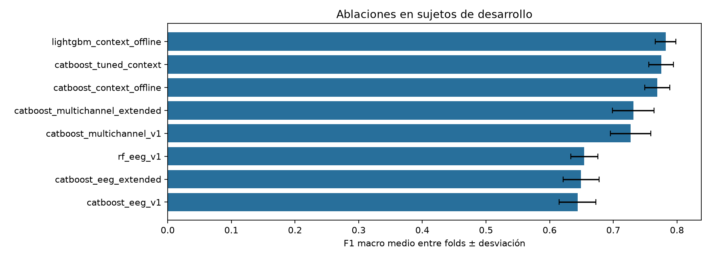
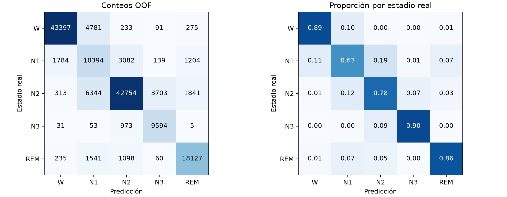
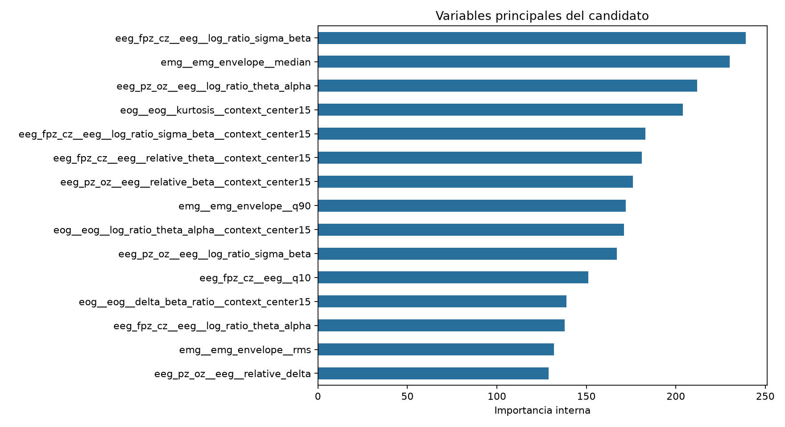

# Resultados de la campaña de mejora de modelos

Campaña iniciada el 15 de noviembre y cerrada el 16 de noviembre de 2026. Notebook ejecutado: [04_literature_catboost.ipynb](../notebooks/04_literature_catboost.ipynb). Método y fuentes: [revisión de literatura y protocolo](literature-model-improvements.md).

El candidato seleccionado es **LightGBM · contexto**, con **F1 macro CV 0,7822 ± 0,0161**, accuracy 0,8167 y kappa 0,7539. Mejora el F1 macro medio en **12.78 puntos** frente a Random Forest recalculado sobre los mismos segmentos.

## Cohorte y controles

Se utilizaron 62 sujetos de desarrollo, 122 registros y 152.052 segmentos de 30 segundos, con las mismas particiones fijas de cinco folds por sujeto. Los 16 sujetos reservados no participaron en entrenamiento, ajuste ni evaluación científica de esta campaña.

La tarea tiene cinco clases. Se conservaron las frecuencias nativas de los canales y el recorte supervisado de vigilia de 30 minutos del protocolo anterior. Las variables temporales utilizan segmentos anteriores y posteriores de un EDF completo; la evaluación corresponde a procesamiento retrospectivo.

## Comparación de modelos

| Modelo | Variables | F1 macro CV | Desviación entre folds | Accuracy CV | Kappa CV |
| --- | ---: | ---: | ---: | ---: | ---: |
| LightGBM · contexto | 435 | 0,7822 | 0,0161 | 0,8167 | 0,7539 |
| CatBoost · contexto ajustado | 435 | 0,7754 | 0,0194 | 0,8207 | 0,7555 |
| CatBoost · contexto | 435 | 0,7690 | 0,0198 | 0,7992 | 0,7332 |
| CatBoost · multicanal ampliado | 145 | 0,7314 | 0,0326 | 0,7636 | 0,6876 |
| CatBoost · multicanal original | 88 | 0,7270 | 0,0318 | 0,7602 | 0,6824 |
| Random Forest · EEG original | 25 | 0,6544 | 0,0212 | 0,7126 | 0,6120 |
| CatBoost · EEG ampliado | 42 | 0,6493 | 0,0282 | 0,6924 | 0,5947 |
| CatBoost · EEG original | 25 | 0,6438 | 0,0287 | 0,6873 | 0,5877 |

Prueba adicional: el ensamble fijo 50/50 de LightGBM y CatBoost con contexto obtuvo F1 macro 0,7803 ± 0,0171 y accuracy 0,8129. Se conserva el candidato individual con mayor F1 macro.

Los promedios corresponden a cinco folds; la desviación no es un intervalo de confianza. La extracción vectorizada guarda características float32: el RF recalculado (0,6544) no coincide exactamente con el 0,6548 del informe anterior. Las mejoras se calculan frente a la nueva referencia común.

## Aporte de las variables y ajuste

- Las 25 variables originales de Fpz-Cz se ampliaron a 42 con estadísticas robustas, entropía de permutación, dimensión de Petrosian, log-potencias, ratios espectrales, borde espectral y variabilidad entre subventanas.
- La fusión de Fpz-Cz, Pz-Oz, EOG y EMG fue el cambio con mayor aporte inicial: CatBoost pasó de 0,6438 a 0,7270 usando las variables originales por canal.
- Las variables ampliadas multicanal elevaron ese resultado a 0,7314 y el contexto temporal a 0,7690. Se generaron 145 variables por segmento y 290 versiones temporales normalizadas, para 435 entradas.
- La búsqueda de CatBoost comparó tres configuraciones dentro de cada entrenamiento externo, mediante un holdout del 20 % de sus sujetos y detención temprana. Los 15 ensayos internos y sus parámetros quedaron registrados.
- CatBoost ajustado obtuvo 0,7754 de F1 macro y 0,8207 de accuracy. LightGBM obtuvo el mayor F1 macro y se seleccionó según la métrica primaria definida antes de comparar.

El planteamiento se apoyó en [YASA](https://pmc.ncbi.nlm.nih.gov/articles/PMC8516415/) para descriptores y contexto, y en la literatura de [fusión multicanal](https://www.mdpi.com/1424-8220/26/19/6011) para las ablaciones. Las cifras publicadas con otras cohortes, recortes y canales no se comparan directamente con las de esta campaña.

## Resultados por estadio e incertidumbre

| Estadio | RF original · F1 OOF | Candidato · F1 OOF |
| --- | ---: | ---: |
| W | 0,8378 | 0,9181 |
| N1 | 0,3106 | 0,5234 |
| N2 | 0,7890 | 0,8294 |
| N3 | 0,7800 | 0,7915 |
| REM | 0,5566 | 0,8528 |

Con 2.000 remuestreos emparejados de sujetos completos, la diferencia de F1 macro OOF agrupado frente a RF fue 0,1282; IC del 95 % [0,1166, 0,1411]. El remuestreo mantiene juntas todas las noches de un sujeto. El intervalo es condicional a los modelos OOF entrenados y no sustituye el test final ni cubre toda la variabilidad del reentrenamiento.

Frente al segundo candidato (CatBoost · contexto ajustado), la diferencia de F1 macro OOF agrupado fue 0,0065; IC del 95 % [0,0008, 0,0123]. Se distingue esta medida agrupada del promedio por fold de la tabla principal.

La importancia interna de LightGBM se expresa como número de divisiones. Destacan el ratio sigma/beta de Fpz-Cz, la mediana de la envolvente EMG, ratios de Pz-Oz y características de EOG con contexto. Esta medida es descriptiva y puede repartirse entre variables correlacionadas.

## Artefactos y MLflow

- UI local: [MLflow, experimento sleep-cassette-literature-v2](http://127.0.0.1:5002/#/experiments/1).
- Se registraron ocho comparaciones de modelos, 15 subcorridas de ajuste interno, el ensamble fijo y el reentrenamiento del candidato.
- Modelo registrado: `models:/sleep_sc_task5_literature_v2@candidate`; URI inmutable: `models:/m-666d43b627cc44018a8570915279ff90`.
- Archivos locales bajo `var/research/sc-w30-v2/`: `leaderboard.csv`, `campaign.json`, `candidate.joblib`, `tracking-audit.json`, predicciones OOF, métricas por sujeto e imágenes.
- Se comprobó la igualdad de predicciones después de recargar el modelo y la suma unitaria de sus probabilidades. El ejemplo Parquet funciona con `predict_features` a través del tracking HTTP local.
- La primera ejecución interrumpida y el primer intento de registro con un serializador incompatible se conservan en el historial. Los identificadores canónicos de los resultados terminados están en `tracking-audit.json`.

## Validación y siguientes pasos

Se aprobaron 45 pruebas, incluidas las de integración con EDF reales, y se verificaron lint y tipos. El notebook se ejecutó con sus tablas y figuras. Las nuevas pruebas cubren equivalencia de variables originales, señales constantes, independencia de etiquetas, ventanas por registro y huecos, separación por sujeto, ajuste interno y corrupción de caché. La revisión previa al PR añadió controles contra resultados reutilizados tras modificar código o variables, candidatos antiguos tras `--no-refit` y colisiones de identidad del ensamble. Estos controles no modifican las métricas de la campaña ya ejecutada.

El candidato fue reentrenado únicamente con desarrollo. La integración de EDF sin hipnograma requiere eliminar la dependencia de anotaciones del recorte y reconstruir el mismo contrato de variables. Los siguientes experimentos prioritarios son una comparación sin recorte supervisado, ajuste dirigido de LightGBM y una arquitectura secuencial bajo las mismas particiones; el test reservado debe usarse después de congelar la configuración final.
