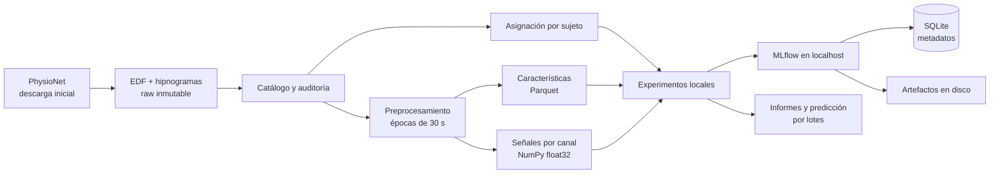

# Infraestructura local para procesamiento y experimentación de Sleep-EDFx

## Objetivo

Construir un entorno local reproducible para descargar Sleep-EDFx, procesar PSG/hipnogramas, extraer características y comparar modelos clásicos y una CNN 1D. MLflow conservará configuraciones, métricas, modelos y artefactos en el equipo.

El primer resultado operativo será ejecutar el flujo completo con un subconjunto pequeño y un EEG; después se ampliará al conjunto principal y a combinaciones de canales. Este documento define trabajo futuro: no constituye una implementación ni una corrida experimental.

## Solicitud y fuentes

- Restricción confirmada durante la implementación: usar exclusivamente Sleep-EDFx real para procesamiento, entrenamiento y comparaciones; no generar datasets sintéticos.
- Solicitud: revisar la propuesta y planificar infraestructura local para procesamiento, feature engineering y experimentación, incluyendo MLflow.
- Documento revisado: `Tema 2. Propuesta_Proyecto IBIO (1).pdf`, cuatro páginas; datos en página 2, resultados y requisitos técnicos en página 3.
- Plan: `plans/20261020-1943-infraestructura-local-sleep-edfx-mlflow.md`.
- Responsable/issue: no definido.
- Documentación técnica consultada el 20 de octubre de 2026; las decisiones de arquitectura siguientes son propuestas para este proyecto.

## Estado inicial del workspace

- Solo se encontró el PDF como contenido del proyecto. No existen código, datasets, notebooks, manifiestos Python, pruebas ni configuración de MLflow.
- La carpeta no es un repositorio Git y no se encontraron instrucciones `AGENTS.md` aplicables.
- Entorno observado: macOS sobre ARM64, con `uv` disponible. No se verificaron RAM total ni disponibilidad real de MPS.
- Espacio libre observado: aproximadamente 127 GiB; deberá comprobarse nuevamente antes de descargar y transformar datos.
- No existen convenciones de implementación que sea necesario conservar. Las rutas y comandos de las secciones siguientes son nuevos contratos propuestos.

## Hallazgos y requisitos derivados

| Evidencia | Consecuencia para el desarrollo |
| --- | --- |
| El PDF exige épocas de 30 segundos y separación por sujeto. | Mantener sujeto y noche en todos los artefactos; ninguna noche de un sujeto podrá cruzar particiones. |
| La propuesta permite un EEG, ambos EEG y EOG/EMG opcionales. | Configurar perfiles de canales; exigir al menos un EEG y registrar exactamente qué combinación usa cada modelo. |
| El documento menciona cinco estadios y añade M como sexta clase. | Implementar tareas configurables de cinco y seis clases, con métricas y modelos independientes. |
| El PDF recomienda modelos clásicos y aprendizaje profundo. | Compartir particiones, etiquetas y evaluación entre características tabulares y señales para CNN. |
| Se requieren exactitud, F1 macro y matrices de confusión. | Esas salidas serán obligatorias para toda comparación formal. |

Sleep-EDFx tiene dos subconjuntos con diferencias relevantes: Sleep Cassette contiene 153 registros y Sleep Telemetry 44; en Cassette el EMG es una envolvente RMS a 1 Hz, mientras que en Telemetry es señal a 100 Hz. Las noches de Telemetry incluyen condiciones de placebo y temazepam. Estas diferencias impiden tratar todos los EMG como señales equivalentes. [Fuente: PhysioNet](https://physionet.org/content/sleep-edfx/1.0.0/).

## Alcance

### Incluido

- Entorno Python, configuración validada y comandos locales repetibles.
- MLflow Tracking y registro local de modelos, con persistencia y respaldo.
- Descarga selectiva/reanudable, inventario y trazabilidad de archivos.
- Lectura EDF/EDF+, control de calidad, alineación y segmentación.
- Características por época y almacenamiento de señales para deep learning.
- Particiones por sujeto, entrenamiento de referencia, comparación y selección reproducible.
- Notebooks exploratorios que reutilicen el código del paquete.
- Exportación y predicción por lotes local para verificar que el modelo puede recargarse.
- Documentación en español para instalar, ejecutar y detener el entorno local, con una guía completa del piloto.

### Fuera del alcance de esta etapa

- Nube, infraestructura remota, Kubernetes y procesamiento distribuido.
- Plataforma web de carga de PSG, autenticación, API propia o servicio de inferencia.
- Validación clínica, uso asistencial y promesas de exactitud objetivo.
- Reproducir todas las arquitecturas de los artículos o ejecutar una búsqueda extensa.
- Exigir que un único modelo maneje todas las combinaciones de canales. Se usará un modelo identificado por perfil.
- Entrenar toda la matriz de experimentos antes de comprobar que el flujo mínimo funciona.

## Decisiones y supuestos

1. Usar Python 3.12 y `uv`; resolver versiones compatibles durante la implementación y fijarlas en `uv.lock`. Evitar instalar dependencias globales. El lockfile y `--locked` permitirán detectar cambios involuntarios del entorno. [Documentación de uv](https://docs.astral.sh/uv/concepts/projects/sync/).
2. Ejecutar procesamiento, notebooks y entrenamiento directamente en macOS. No requerir Docker para el flujo inicial.
3. Usar Sleep Cassette como cohorte experimental inicial; incorporar Telemetry al catálogo y al procesamiento mediante adaptadores separados. Su análisis experimental será una ampliación identificada por cohorte.
4. Descargar primero unas pocas noches para validar ingeniería. Esa muestra no sirve para sostener resultados científicos.
5. Soportar `task_6`: W, N1, N2, N3, REM y M; y `task_5`: los mismos estadios sin M. Una preferencia posterior cambia la campaña, no el contrato de datos.
6. Conservar anotaciones originales; mapear R a REM y 3/4 a N3; excluir `?` del aprendizaje supervisado y contabilizar su exclusión.
7. Trabajar inicialmente con épocas independientes. Los modelos secuenciales y las ventanas de contexto quedan para una ampliación que respete noches y discontinuidades.
8. Usar archivos locales y manifiestos con hashes para trazabilidad. No introducir un feature store, un servidor de objetos ni una base adicional para las características.

## Arquitectura propuesta



Los datos y paquetes se descargan durante la preparación. Después, los pasos de procesamiento y entrenamiento deben poder funcionar sin red externa, usando únicamente el servidor MLflow local.

| Componente | Elección propuesta | Responsabilidad |
| --- | --- | --- |
| Entorno | Python 3.12, uv | Instalación y bloqueo de dependencias. |
| Señales | MNE-Python, NumPy, SciPy | Lectura, filtros, segmentación y extracción. |
| Tablas | pandas, PyArrow/Parquet | Catálogo, índices, características y predicciones. |
| Modelos clásicos | scikit-learn; LightGBM como extra | DummyClassifier, Random Forest y boosting opcional. |
| Deep learning | PyTorch como extra | CNN 1D pequeña; CPU o MPS si está disponible. |
| Seguimiento | MLflow con SQLite y disco local | Runs, métricas, artefactos y versiones de modelos. |
| Configuración y CLI | YAML, Pydantic, Typer | Validación de parámetros y comandos. |
| Exploración | JupyterLab, matplotlib | Auditoría y análisis de experimentos. |
| Calidad | pytest, Ruff, mypy | Pruebas, formato, lint y tipos. |

### Recursos y límites iniciales

- Perfil conservador: un registro por proceso, dos workers como máximo y un experimento de entrenamiento activo.
- Parámetros configurables: workers, threads del estimador, batch size, épocas y límite de ensayos. Evitar multiplicar paralelismo entre folds, BLAS y modelos.
- Reservar inicialmente entre 40 y 60 GB como presupuesto de trabajo, sujeto a medición; no es una estimación garantizada. El tamaño publicado del dataset bruto completo es 8,1 GB. [Fuente: PhysioNet](https://physionet.org/content/sleep-edfx/1.0.0/).
- Medir tiempo, memoria y disco con el piloto antes de escalar. Conservar una copia canónica de señales por versión de procesamiento; los perfiles de canales serán vistas, no duplicados.
- CPU será la ruta obligatoria de referencia. La aceleración MPS se habilitará tras comprobar `torch.backends.mps.is_available()` y una prueba de entrenamiento. Registrar dispositivo y diferencias numéricas. [Documentación de PyTorch](https://docs.pytorch.org/docs/2.14/notes/mps.html).

## MLflow e integración de servicios

No se requiere backend/API propia. El único servicio HTTP será MLflow en `http://127.0.0.1:5001`; el cliente deberá verificar que está disponible antes de entrenar.

Persistencia propuesta:

- `var/mlflow/mlflow.db`: experimentos, runs y metadatos del registro de modelos.
- `var/mlflow/artifacts/`: modelos, configuraciones, métricas detalladas y gráficos.
- `var/backups/`: respaldos locales consistentes.
- `MLFLOW_TRACKING_URI=http://127.0.0.1:5001`: compartida por CLI y notebooks.

Tras crear directorios, `make mlflow` ejecutará en primer plano, desde la raíz:

```bash
uv run --locked mlflow server \
  --host 127.0.0.1 \
  --port 5001 \
  --backend-store-uri sqlite:///var/mlflow/mlflow.db \
  --serve-artifacts \
  --artifacts-destination ./var/mlflow/artifacts
```

Se usará el servidor como intermediario de artefactos; no combinar este modo con `--default-artifact-root`. SQLite y el filesystem son suficientes para la ejecución local inicialmente secuencial. [Arquitectura de MLflow](https://mlflow.org/docs/latest/self-hosting/architecture/tracking-server/).

Cada experimento tendrá un run padre y runs hijos por fold/ensayo. Registrar:

- Configuración resuelta, semilla, cohorte, canales, tarea y política de épocas.
- Hash del catálogo, versión de procesamiento, versión de features y hash de particiones.
- Commit y estado del código; si todavía no hay Git, hash del código fuente.
- Lockfile, versiones relevantes, dispositivo, tiempos y consumo medido.
- Hiperparámetros, tamaño de cada partición y soporte por clase.
- Accuracy, F1 macro, métricas por clase, matriz de confusión y predicciones OOF.
- Pipeline/modelo, normalizador, orden de características o canales y contrato de entrada.
- Estado explícito de fallo y artefactos disponibles si una ejecución se interrumpe.

No copiar el dataset completo al almacén de MLflow. Registrar manifiestos y referencias verificables. El registro local identificará modelos por cohorte, tarea y perfil; un alias `candidate` permitirá recargar la versión seleccionada por validación sin confundir perfiles.

## Datos, contratos y persistencia

### Estructura de almacenamiento

```text
data/
  raw/sleep-edfx/1.0.0/{sleep-cassette,sleep-telemetry}/
  manifests/{files.parquet,recordings.parquet,channels.parquet}
  interim/<preprocessing_id>/<recording_id>/<channel>.npy
  interim/<preprocessing_id>/epochs.parquet
  processed/<preprocessing_id>/<feature_set_id>/features.parquet
  splits/<split_id>/{subjects.parquet,folds.parquet,metadata.json}
var/
  mlflow/{mlflow.db,artifacts/}
  reports/<experiment_id>/
  backups/
```

Los directorios de datos y `var/` se excluyen de Git. Código, configuración, lockfile y manifiestos pequeños de procedencia usados para publicar resultados se versionan; los manifiestos operativos completos se conservan como artefactos.

### Esquemas mínimos

| Entidad | Campos y reglas principales |
| --- | --- |
| Archivo | URL, ruta relativa, versión del dataset, tamaño, SHA-256, estado de descarga/verificación. |
| Registro | `recording_id`, `subject_id` con prefijo de cohorte, cohorte, noche, PSG/hipnograma y duración. Las condiciones de Telemetry se registran cuando estén verificadas en sus metadatos. |
| Canal | Nombre original/canónico, unidad original, conversión aplicada, frecuencia nativa, representación y disponibilidad. |
| Época | Clave única `recording_id + onset_sample_eeg`, inicio en segundos, duración, anotación original, etiqueta de cada tarea, calidad y motivo de exclusión. |
| Características | Clave de época, versión del extractor y columnas numéricas con prefijo de canal/representación. |
| Partición | Sujeto, desarrollo/test, fold y semilla. Un sujeto tiene una sola asignación por protocolo. |
| Predicción | Run, época, tarea, etiqueta real/predicha y probabilidades en un orden de clases persistido. |

No incluir identificadores, anotaciones, fold, nombre del archivo, cohorte ni metadatos de tratamiento como características predictoras iniciales.

No hay migraciones de una base de aplicación existente. Añadir `schema_version` a los metadatos y generar una nueva carpeta al cambiar contratos; no sobrescribir artefactos científicos de versiones anteriores.

### Lectura, calidad y segmentación

- Emparejar PSG e hipnograma por identificador verificado; no depender del orden del listado ni de que sus sufijos completos coincidan.
- Validar disponibilidad de canales, unidades, frecuencias, duraciones, NaN/Inf, saturación y segmentos planos.
- Leer por grupos de canales con la misma frecuencia. MNE eleva a la frecuencia mayor cuando se cargan señales de frecuencias diferentes: no usar ese comportamiento para convertir implícitamente la envolvente EMG en una señal de alta frecuencia. [Documentación del lector EDF](https://mne.tools/stable/generated/mne.io.read_raw_edf.html).
- Preservar la derivación bipolar ya registrada; no añadir una nueva referencia EEG por defecto.
- Proponer como configuración inicial EEG 0,3–35 Hz y EOG 0,3–15 Hz; verificar respuesta y efectos de borde sobre el piloto. El EMG tendrá parámetros propios según su representación. No aplicar notch automáticamente.
- Filtrar cada registro/canal de forma consistente, con márgenes y tratamiento de bordes documentados; nunca concatenar noches para filtrar.
- Usar intervalos de 30 segundos sin solapamiento, alineados al hipnograma y al inicio de señal. A 100 Hz cada época tiene exactamente 3000 muestras; la envolvente a 1 Hz tiene 30.
- Expandir anotaciones largas únicamente en épocas completas con una etiqueta inequívoca. Detectar huecos, solapamientos y desalineación; excluir intervalos ambiguos con motivo, sin rellenarlos como W.
- Eliminar épocas incompletas del final y reportarlas. Mantener el tiempo original tras excluir épocas para no crear continuidad ficticia.
- La calidad técnica y la etiqueta M son conceptos distintos: conservar M cuando la señal sea utilizable; no eliminarla automáticamente por reglas de artefactos.
- Mantener como protocolo principal todas las épocas supervisadas válidas. Ofrecer un protocolo independiente con recorte de vigilia alrededor del sueño para comparaciones bibliográficas; identificarlo como evaluación dependiente de anotaciones y no como requisito de inferencia. El tutorial de MNE usa un recorte de 30 minutos a cada lado. [Referencia de MNE](https://mne.tools/stable/auto_tutorials/clinical/60_sleep.html).

## Feature engineering y perfiles de entrada

### Primera versión de características

| Señal | Características propuestas |
| --- | --- |
| EEG | Media, desviación, RMS, cuantiles, asimetría, curtosis, cruces por cero y parámetros de Hjorth. |
| EEG espectral | Welch; potencia absoluta/relativa en delta 0,5–4, theta 4–8, alfa 8–12, sigma 12–16 y beta 16–30 Hz; entropía espectral y razones con denominadores protegidos. |
| Dos EEG | Diferencias/razones de potencia y correlación por época, solo para perfiles que tengan ambos canales. |
| EOG | Estadísticos temporales, derivadas y potencia de baja frecuencia con parámetros registrados. |
| EMG envolvente | Nivel, variabilidad, cuantiles y cambios temporales; no calcular bandas propias del EMG crudo. |
| EMG crudo | Estadísticos de amplitud y potencia en bandas compatibles con su frecuencia de muestreo. |

Estas son características iniciales para experimentar, no una afirmación sobre su desempeño. Registrar unidades, bandas, resolución espectral y definición exacta de cada columna.

La extracción por época será determinista. Imputación, escalado, selección de variables y cualquier estadística aprendida se ajustarán dentro del conjunto de entrenamiento de cada fold. Para CNN se persistirán los parámetros de normalización del entrenamiento.

Hay 12 perfiles válidos: tres selecciones de EEG —Fpz-Cz, Pz-Oz o ambos— por cuatro selecciones auxiliares —ninguna, EOG, EMG o ambos—. Generarlos en `configs/channels.yaml` y probar su validación.

- Cada perfil declara canales obligatorios y representación EMG aceptada.
- Ante un canal obligatorio ausente, excluir ese registro con reporte durante la construcción de la cohorte o rechazar la predicción; no sustituirlo silenciosamente por ceros.
- Para comparar perfiles, usar una intersección predefinida de sujetos/épocas elegibles y reportar además cobertura sobre el conjunto original.
- Extraer una sola tabla amplia y seleccionar columnas por perfil. Las ramas CNN leerán señales canónicas sin duplicarlas.
- La primera CNN usará un EEG. Una ampliación multimodal usará ramas/fusión para entradas de distinta frecuencia; no inventar información interpolando EMG a 1 Hz como si fuera señal cruda.

## Protocolo experimental

1. **Congelar sujetos:** reservar aproximadamente 20 % de sujetos como test con asignación determinista antes de experimentar. Mantener todas las noches de cada sujeto juntas.
2. **Desarrollo:** usar cinco folds agrupados por sujeto en el resto; `StratifiedGroupKFold` ayudará a aproximar el balance. Auditar soporte por clase porque la estratificación no garantiza que todas las clases estén presentes. [Documentación de scikit-learn](https://scikit-learn.org/stable/modules/cross_validation.html#stratifiedgroupkfold).
3. **Comparabilidad:** persistir las particiones y reutilizarlas en todos los modelos/perfiles compatibles. Las tareas de cinco y seis clases compartirán la asignación de sujetos.
4. **Modelos:** DummyClassifier, Random Forest y CNN 1D pequeña. Añadir LightGBM después de validar instalación y beneficio operativo; no es requisito para levantar la infraestructura.
5. **Presupuesto:** empezar con configuraciones fijas. Una búsqueda posterior tendrá límite explícito, por ejemplo ocho configuraciones clásicas por perfil y tres de CNN; medir el coste antes de ampliarla.
6. **Balance y selección:** calcular pesos de clase solo sobre entrenamiento; cualquier remuestreo se hace dentro del fold. CNN usará una validación interna agrupada para early stopping, separada del fold externo.
7. **Métricas:** accuracy, F1 macro con lista fija de clases, precision/recall/F1/soporte por estadio y matriz de confusión absoluta/normalizada. Añadir kappa y resúmenes por sujeto como métricas complementarias.
8. **Resumen:** conservar predicciones OOF, métricas por fold y agregadas; indicar que son resultados usados para selección. Reportar incertidumbre final mediante remuestreo de sujetos, no de épocas independientes.
9. **Selección final:** elegir por F1 macro de desarrollo; en empates predefinidos, preferir menor coste y menos canales. Reentrenar con desarrollo completo; fijar las épocas CNN a partir de la validación interna, sin usar test.
10. **Test:** evaluar la configuración congelada al final; no usar test para escoger bandas, canales, recorte de vigilia o hiperparámetros.
11. **Cinco frente a seis clases:** entrenar un benchmark de cinco clases de manera independiente excluyendo M. Si también se muestra el modelo de seis clases sobre épocas sin M, etiquetarlo como análisis adicional y contar sus predicciones M como errores.
12. **Soporte escaso:** si un entrenamiento de seis clases no contiene ejemplos de M, declarar el protocolo inviable para ese split. No cambiar clases ni particiones silenciosamente; decidir el ajuste científico antes de esa campaña.
13. **Bibliografía:** preparar una tabla con cohorte, sujetos, canales, clases, política de vigilia, partición y métricas de cada artículo. Comparar cifras únicamente cuando esos protocolos sean compatibles.
14. **Telemetry:** mantener resultados separados por cohorte/condición. Un modelo congelado entrenado con Cassette podrá evaluarse en canales semánticamente compatibles; no denominar Telemetry test externo si ya se utilizó para ajustar ese modelo.

## Mapa de archivos a crear

Todos los siguientes archivos son nuevos. Crear los `__init__.py` necesarios para los paquetes.

| Ruta | Acción y propósito |
| --- | --- |
| `pyproject.toml`, `uv.lock`, `.python-version` | Dependencias, build del paquete, entry point `sleep-stage`, grupos dev/notebook y extras dl/boosting; configurar pytest, Ruff y mypy. |
| `.gitignore`, `.env.example`, `Makefile`, `README.md` | Excluir datos/estado; documentar variables, instalación y comandos; incluir un inicio rápido local enlazado a `docs/local-operations.md`. |
| `configs/local.yaml`, `configs/channels.yaml` | Rutas, límites, tracking y los 12 perfiles. |
| `configs/data/pilot.yaml`, `configs/data/sleep-cassette.yaml`, `configs/data/sleep-telemetry.yaml` | Selección explícita de registros/cohortes. |
| `configs/experiments/rf-eeg.yaml`, `configs/experiments/cnn-eeg.yaml`, `configs/experiments/smoke.yaml` | Experimentos iniciales y prueba rápida con el piloto real. |
| `src/sleep_staging/cli.py`, `config.py`, `provenance.py` | CLI, validación y fingerprints de datos/configuración/código. |
| `src/sleep_staging/data/download.py`, `catalog.py`, `edf.py` | Descarga verificada, catálogo y lectura por representación/frecuencia. |
| `src/sleep_staging/data/labels.py`, `preprocess.py`, `splits.py` | Mapeos, épocas y particiones sin fuga. |
| `src/sleep_staging/features/extract.py` | Extracción y selección de features por perfil. |
| `src/sleep_staging/models/classical.py`, `cnn.py` | Pipelines tabulares y CNN/dataset de PyTorch. |
| `src/sleep_staging/tracking.py`, `experiments.py` | Cliente MLflow, runs y entrenamiento por folds. |
| `src/sleep_staging/evaluation.py`, `inference.py` | Métricas, informes y recarga/predicción por lotes. |
| `scripts/backup_mlflow.py` | Copia consistente y manifiesto de integridad, con servidor detenido. |
| `notebook/01_data_audit.ipynb`, `02_feature_analysis.ipynb`, `03_experiment_review.ipynb` | Exploración y revisión mediante llamadas al paquete. |
| `tests/conftest.py`, `tests/fixtures/` | Anotaciones para pruebas de lógica; integración y entrenamiento con los EDF reales descargados. |
| `tests/unit/test_config.py`, `test_labels_epochs.py`, `test_features.py`, `test_splits.py`, `test_provenance.py` | Contratos, señales y aislamiento. |
| `tests/integration/test_mlflow.py`, `test_pipeline.py`, `test_inference.py` | Servicio temporal, pipeline y recarga. |
| `docs/data-contract.md`, `docs/local-operations.md`, `docs/experiment-protocol.md` | Contratos, guía completa de ejecución local con respaldo/restauración y metodología experimental. |

## Documentación obligatoria de ejecución local

La implementación deberá entregar documentación en español que permita a una persona ejecutar el piloto desde una copia nueva del proyecto, sin depender de esta conversación. Mantener un inicio rápido en `README.md` y la guía detallada en `docs/local-operations.md`, con enlaces entre ambos.

La guía deberá cubrir:

1. **Requisitos previos:** sistema soportado, instalación de Python/uv, espacio y memoria requeridos según las mediciones del piloto, y diferencias entre CPU y MPS.
2. **Instalación:** comandos desde la raíz del proyecto para preparar el entorno con el lockfile existente e instalar los grupos y extras necesarios; distinguir la primera instalación de las ejecuciones posteriores.
3. **Configuración:** preparación de `.env` a partir de `.env.example`, cómo cargan las variables la CLI y los notebooks, rutas locales y selección de cohorte, tarea y canales.
4. **Arranque de MLflow:** creación de directorios, comando en una terminal dedicada, URL de la interfaz, comprobación de conexión y ubicación de metadatos/artefactos.
5. **Ejecución de punta a punta:** comandos ordenados para descargar y auditar el piloto, preparar épocas, extraer features, generar particiones, entrenar y consultar informes. Para cada paso, indicar entradas, salidas y una comprobación de éxito.
6. **Notebooks:** comando para iniciar JupyterLab, selección del kernel del proyecto y orden de los notebooks; explicar qué datos necesitan y qué pasos ejecutan.
7. **Consulta de resultados:** localizar runs, métricas y modelos en MLflow, identificar archivos generados y ejecutar una predicción por lotes con un modelo recargado.
8. **Operación posterior:** detener procesos, reiniciar conservando resultados, reutilizar caché, reanudar pasos fallidos y efectuar respaldo/restauración.
9. **Problemas frecuentes:** puerto ocupado, MLflow no disponible, kernel o dependencias incorrectos, canales ausentes, descarga incompleta, falta de memoria/disco y MPS no disponible; indicar diagnóstico y solución para cada caso.

Los comandos publicados deberán coincidir con la CLI y configuración realmente implementadas. Identificar qué comandos requieren Internet y cuáles funcionan solo con los recursos locales ya preparados.

## Fases de implementación

### Fase 1 — Base reproducible

- [x] Crear entorno y estructura del paquete, configuración y documentación.
- [x] Redactar el inicio rápido de `README.md` y la instalación/configuración de `docs/local-operations.md`.
- [x] Definir dependencias base, grupos dev/notebook y extras dl/boosting; generar el lockfile.
- [x] Implementar `sleep-stage doctor`: rutas, espacio, versiones, CPU/MPS y límites efectivos.
- [x] Configurar Ruff, mypy y pytest; definir marcadores de integración y datos reales.
- [x] Si se adopta Git, inicializarlo antes de registrar experimentos y conservar el PDF como fuente.
- Salida verificable: instalación bloqueada y validación de las configuraciones en CPU.

### Fase 2 — MLflow persistente

- [x] Implementar `make init-dirs` y `make mlflow`.
- [x] Añadir tracking explícito y comprobación previa de conexión; no caer silenciosamente en otro almacén.
- [x] Registrar una corrida con el piloto real, parámetros, métrica, artefacto y modelo; recargarlo.
- [x] Documentar detención con Ctrl+C, persistencia tras reinicio y respaldo/restauración.
- Salida verificable: la corrida y su artefacto siguen accesibles después de reiniciar MLflow.

### Fase 3 — Descarga y catálogo

- [x] Implementar `download` con archivos temporales, timeouts, reintentos acotados y verificación; reanudar solo cuando el servidor admita rangos, o reiniciar el archivo parcial.
- [x] Registrar hashes oficiales cuando estén disponibles y SHA-256 local; no considerar un hash local prueba de autenticidad.
- [x] Implementar `audit`: pares PSG/hipnograma, sujetos, noches, canales, frecuencias y etiquetas.
- [x] Descargar el piloto, producir el catálogo y registrar su procedencia en MLflow.
- Salida verificable: repetir la descarga no duplica ni corrompe archivos; inventario completo del piloto.

### Fase 4 — Preprocesamiento y épocas

- [x] Implementar lector, mapeos, segmentación y controles de calidad iniciales: NaN/Inf, duraciones y segmentos planos.
- [ ] Añadir detección de saturación y umbrales de artefactos validados con los investigadores.
- [x] Persistir señales float32 por canal y un índice de épocas con razones de exclusión.
- [x] Calcular un fingerprint a partir de entradas, configuración, código y versiones relevantes.
- [x] Escribir resultados de forma atómica; reutilizar caché solo con fingerprint idéntico.
- [x] Medir memoria/disco/tiempo; ajustar límites antes de procesar toda Cassette.
- Salida verificable: épocas alineadas, sin pérdida de procedencia y sin confundir las representaciones EMG.

### Fase 5 — Features y particiones

- [x] Implementar y versionar características deterministas por época.
- [x] Validar los 12 perfiles, columnas esperadas y cohortes elegibles.
- [x] Crear particiones persistentes por sujeto y verificar soporte por clase.
- [x] Crear los notebooks de auditoría y análisis; evitar duplicar lógica del paquete.
- Salida verificable: misma configuración produce los mismos índices, features y asignaciones.

### Fase 6 — Experimentación integrada

- [x] Implementar baseline dummy y Random Forest con preprocesamiento aprendido dentro de cada fold.
- [x] Implementar CNN 1D EEG, normalización de entrenamiento y checkpoints.
- [x] Ejecutar una prueba corta con el piloto real y después comparar modelos sobre las mismas particiones.
- [ ] Ampliar a Cassette para una comparación formal con cinco folds y test reservado.
- [ ] Implementar la evaluación final separada de test y sus intervalos mediante bootstrap de sujetos.
- [x] Registrar métricas, predicciones, informes y artefactos; seleccionar y recargar un candidato.
- [x] Habilitar campañas por perfiles y tareas sin exigir que todas se ejecuten en este hito.
- Salida verificable: desde una configuración se puede entrenar, comparar y recargar un modelo con trazabilidad completa.

### Fase 7 — Operación y ampliaciones

- [x] Probar respaldo/restauración y funcionamiento sin red externa tras la preparación.
- [x] Documentar cómo regenerar derivados y recuperar una ejecución fallida.
- [x] Completar la guía local y comprobar sus comandos siguiendo únicamente la documentación, desde un entorno nuevo hasta un run y una predicción del piloto; registrar correcciones y resultados esperados.
- [ ] Procesar Telemetry con su adaptador y auditar diferencias antes de cualquier campaña conjunta.
- [ ] Priorizar perfiles adicionales, LightGBM y fusión multimodal según métricas y presupuesto observado.
- Salida verificable: guía operativa ejecutable y lista explícita de campañas realizadas/pendientes.

Orden de dependencia: 1 → 2 → 3 → 4 → 5 → 6 → 7. La primera entrega útil llega al terminar la fase 6 sobre el piloto; los resultados científicos requieren completar la comparación formal.

## Pruebas y escenarios

| Área | Verificación significativa |
| --- | --- |
| Configuración | Rechazar perfiles sin EEG, rutas inválidas y parámetros espectrales incompatibles con Nyquist. |
| Lectura EDF | Fixture real de formato con frecuencias distintas; preservar unidades, frecuencia y origen temporal. |
| Etiquetas/épocas | 3+4 → N3, R → REM, M según tarea, ? excluida; 3000/30 muestras; anotaciones largas, huecos, solapamientos y final incompleto. |
| Calidad | Señal plana, NaN/Inf y saturación; conservar M utilizable y reportar cada exclusión. |
| Features | Señales sinusoidales conocidas concentran potencia en la banda esperada; señal cero no produce infinitos. |
| Fuga de información | Dos noches del mismo sujeto nunca cruzan particiones; modificar test no altera escaladores ni pesos de clase de entrenamiento. |
| Caché | Repetir reutiliza salidas; cambiar entrada, configuración o código relevante invalida el fingerprint. |
| MLflow | Servidor temporal con SQLite y puerto libre; crear run, subir/descargar artefacto, registrar/recargar modelo y reiniciar. |
| Pipeline | EDF real de Sleep-EDFx → épocas → features → split → modelo → métricas; descarga explícita previa a las pruebas de integración. |
| Inferencia | Recarga reproduce probabilidades dentro de tolerancia; contrato incompatible o canal obligatorio ausente falla con un mensaje claro. |
| Recuperación | Descarga truncada y fallo de entrenamiento no marcan resultados incompletos como finalizados; restauración valida metadatos y artefactos. |
| Dispositivos | CPU obligatoria; MPS opcional con tolerancias declaradas, sin exigir igualdad bit a bit entre dispositivos. |
| Documentación local | Seguir el inicio rápido y la guía desde un entorno nuevo; completar el piloto, consultar el run en MLflow, recargar el modelo y detener/reiniciar los procesos con los resultados documentados. |

## Comandos de validación y operación

Estos comandos son contratos a implementar; hoy todavía no existen. Ejecutarlos desde la raíz.

```bash
# Preparación durante implementación; el lockfile se genera una vez y se conserva.
uv lock
uv sync --locked --group dev --group notebook --extra dl

# Calidad del código.
uv run --locked ruff format --check src tests scripts
uv run --locked ruff check src tests scripts
uv run --locked mypy src/sleep_staging scripts
uv run --locked pytest tests/unit -q
uv run --locked pytest tests/integration -q

# Servicio local, en una terminal dedicada.
make init-dirs
make mlflow

# Diagnóstico y prueba corta con datos reales.
uv run --locked sleep-stage download --config configs/data/pilot.yaml
uv run --locked sleep-stage doctor --check-mlflow
uv run --locked sleep-stage experiment --config configs/experiments/smoke.yaml

# Preparación y verificación del piloto.
uv run --locked sleep-stage download --config configs/data/pilot.yaml
uv run --locked sleep-stage audit --config configs/data/pilot.yaml
uv run --locked sleep-stage prepare --config configs/experiments/rf-eeg.yaml
uv run --locked sleep-stage features --config configs/experiments/rf-eeg.yaml
uv run --locked sleep-stage split --config configs/experiments/rf-eeg.yaml

# Las configuraciones experimentales referencian los mismos IDs de datos y splits.
uv run --locked sleep-stage experiment --config configs/experiments/rf-eeg.yaml
uv run --locked sleep-stage experiment --config configs/experiments/cnn-eeg.yaml
uv run --locked sleep-stage report --config configs/experiments/rf-eeg.yaml
```

Durante el piloto, las configuraciones experimentales referenciarán la selección piloto y un protocolo corto explícito; al pasar a Cassette completo se crearán nuevos IDs de datos/splits. No reutilizar resultados piloto como evidencia de cinco folds sobre la cohorte completa.

La CLI también deberá definir `predict` con URI de modelo y entrada, y `evaluate-test` para la evaluación final separada; documentar su contrato en README al implementarlos.

## Riesgos, mitigación y recuperación

| Riesgo | Mitigación | Recuperación |
| --- | --- | --- |
| Poco soporte de M o N1 | Auditar soporte por sujeto, fold y tarea; no ocultar clases ausentes. | Detener la campaña inviable y documentar un nuevo protocolo antes de repetir. |
| Fuga por noches, normalización o selección de features | Particiones persistentes y ajustes solo en entrenamiento. | Invalidar runs afectados y regenerar únicamente derivados/protocolos corregidos. |
| EMG de distinta naturaleza | Contratos explícitos por cohorte/representación. | Reprocesar la versión afectada sin modificar EDF originales. |
| RAM/disco insuficientes | Procesamiento por registro, float32, lectura diferida y medición del piloto. | Reducir workers/batch size o borrar solo derivados regenerables identificados. |
| MPS o LightGBM incompatibles | CPU obligatoria y dependencias opcionales. | Ejecutar el baseline en CPU con entorno bloqueado. |
| Corrupción o pérdida de seguimiento | Detener servidor y clientes antes de copiar SQLite y artefactos; manifiesto de integridad. | Restaurar juntos DB/artefactos en otra carpeta y verificar un run y modelo antes de usarla. |
| Actualización de MLflow o librerías | Copia previa y lockfile; probar migraciones en una copia. | Restaurar entorno y persistencia compatibles, sin degradar una DB ya migrada. |
| Resultados bibliográficos incompatibles | Documentar cohorte, canales, clases y recorte. | Presentar comparación cualitativa cuando no exista un protocolo equivalente. |

La recuperación conserva siempre el PDF y los datos brutos. No incluir comandos de limpieza que eliminen indiscriminadamente `data/` o `var/`.

## Preguntas abiertas

No hay decisiones que bloqueen construir la infraestructura propuesta. Antes de una campaña científica completa se deberá resolver:

- Prioridad de la tarea de cinco o seis clases; ambas están cubiertas por el contrato.
- RAM disponible, tamaño máximo de disco y presupuesto de tiempo medidos en el piloto.
- Viabilidad estadística de seis clases según la distribución real de M.
- Artículos/protocolos concretos con los cuales se hará la comparación final.

## Criterios de aceptación y definición de terminado

- [x] Entorno reproducible desde `uv.lock`; Ruff, mypy y pruebas relevantes pasan.
- [x] MLflow funciona en localhost; un reinicio conserva runs, artefactos y modelos.
- [x] Pipeline completo sobre el piloto real de Sleep-EDFx, con inventario y SHA-256 verificables.
- [x] Épocas de 30 s, mapeos explícitos y exclusiones auditables.
- [x] Los 12 perfiles se validan y la ruta inicial de un EEG funciona de punta a punta.
- [x] Pruebas demuestran separación por sujeto y ausencia de ajuste sobre test.
- [x] Random Forest y CNN generan runs comparables sobre las mismas particiones compatibles.
- [x] Cada run identifica configuración, datos, código, entorno, clases, canales y splits.
- [x] Un modelo recargado produce predicciones locales con su contrato de entrada.
- [x] Respaldo/restauración verificados; documentación permite repetir la operación.
- [x] `README.md` enlaza una guía local completa en español, con comandos comprobados de instalación, configuración, MLflow, pipeline, notebooks, predicción, detención y solución de problemas.
- [x] Queda distinguido qué es prueba piloto, qué campaña formal se ejecutó y qué ampliaciones siguen pendientes.

## Notas de entrega

Implementar primero el recorrido mínimo de un EEG con el piloto real de Sleep-EDFx. Usar funciones compartidas desde CLI y notebooks. Actualizar este checklist con evidencia de cada hito, sin atribuir resultados a pruebas todavía no ejecutadas.

La plataforma web y el despliegue final descritos en el PDF requerirán otro plan. Los contratos de canales, modelos y preprocesamiento definidos aquí serán su punto de integración.

## Avance verificado — 20 de octubre de 2026

- Rama local: `feature/infraestructura-local-sleep-edfx-mlflow`. Repositorio nuevo, sin commits ni remoto; se conserva el PDF original.
- Se implementó el entorno, MLflow, descarga/auditoría, preprocesamiento, features, particiones, Random Forest, CNN, inferencia por lotes, notebooks y documentación local.
- Se retiró la ruta de generación de datos: procesamiento, entrenamiento, comparaciones e integración se ejecutan exclusivamente con Sleep-EDFx real.
- Piloto: ocho registros reales, 381,8 MiB de EDF verificados, 21 948 épocas auditadas y 1920 seleccionadas temporalmente. Se generan 89 características en la tabla amplia; los 12 perfiles se comprobaron sobre esa tabla.
- Comparación en desarrollo con cinco folds por sujeto: Random Forest F1 macro 0,5830 ± 0,1398 y accuracy 0,7800; CNN F1 macro 0,2837 ± 0,0455 y accuracy 0,4625. El baseline obtiene F1 macro 0,1651. Ganador del piloto: Random Forest.
- La CNN se probó en CPU y MPS y registra checkpoints e historial. La selección científica completa aún requiere más datos y experimentación.
- Se verificaron la recarga y predicción de ambos modelos, el reinicio de MLflow y un respaldo restaurado en un servidor temporal independiente. Evidencia operativa local: `var/reports/local-verification.json`.
- Los tres notebooks se ejecutaron con el kernel del proyecto y datos reales; la CLI documentada de predicción se verificó con ambos modelos.
- Validación final: `make check` (Ruff formato/lint y mypy), `make test` (25 pruebas aprobadas) y `uv run --offline --locked sleep-stage experiment --config configs/experiments/rf-eeg.yaml`.
- La advertencia de soporte escaso corresponde a M: la auditoría del piloto encuentra solo 30 segundos de movimiento. Una prueba de integración comprueba que seis clases falla explícitamente si falta soporte de entrenamiento.
- Se conserva el test reservado; no se ejecutó una evaluación científica final sobre él.
- Quedan pendientes la cohorte completa, saturación/artefactos avanzados, evaluación final con incertidumbre, Telemetry, boosting y fusión multimodal. Los contrastes adicionales entre ambos EEG se ampliarán después del perfil inicial.
- Guía de uso: `README.md` y `docs/local-operations.md`; metodología y límites en `docs/experiment-protocol.md`.

## Descarga completa verificada — 20 de octubre de 2026

- Se descargaron los 197 registros reales: 153 de Sleep Cassette (78 identificadores de sujeto) y 44 de Sleep Telemetry (22 identificadores).
- Se conservaron los ocho registros del piloto y se incorporaron los restantes, con sus hipnogramas. También se descargaron `SC-subjects.xls`, `ST-subjects.xls`, `RECORDS` y `RECORDS-v1`.
- Se verificaron globalmente 398 archivos mediante los SHA-256 publicados: 197 PSG, 197 hipnogramas y cuatro metadatos. Tamaño: 8 715 189 781 bytes (8,117 GiB).
- Las dos cohortes se auditaron con el comando `audit`. Resumen e inventarios agregados: `data/manifests/sleep-edfx-complete/`.
- Esta ampliación completa la descarga y auditoría de datos brutos. El procesamiento de señales, entrenamiento y evaluación sobre las cohortes completas continúan pendientes en sus tareas correspondientes.
