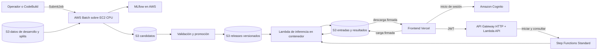

# Despliegue de la estadificación del sueño en AWS y Vercel

**Objetivo.** Que una persona pueda iniciar sesión desde Vercel, enviar una noche, ver el hipnograma predicho y descargar las probabilidades por época. Que el equipo pueda reentrenar en EC2, rastrear cada ajuste en MLflow, publicar una versión en S3 y volver a una versión anterior. Terraform administrará los recursos de AWS y el proyecto y los despliegues de Vercel. GitHub aloja el código existente. AWS CodePipeline y CodeBuild ejecutan la entrega, de modo que Vercel es el único servicio externo que sirve la aplicación.

**Decisión propuesta para la primera entrega.** Servir LightGBM sobre una noche **ya preparada**, con un archivo de ejemplo que se pueda probar desde el navegador. Separar dos hitos permite demostrar primero que AWS reproduce al campeón local y luego que EC2 puede producir un candidato nuevo con el mismo contrato. El entorno inicial es una demo de investigación autenticada, con datos públicos de desarrollo de Sleep Cassette.

## Qué despliegue permite el repositorio hoy

| Evidencia comprobada | Consecuencia para el diseño |
| --- | --- |
| LightGBM ajustado obtuvo F1 macro **0,7893**, exactitud 0,8300 y kappa 0,7691 en cinco folds. La BiLSTM ajustada obtuvo F1 macro 0,7800. | La primera versión usa LightGBM en CPU. La cohorte de comparación tiene 62 sujetos. Los 16 del test quedan reservados. [Resultados del proyecto](../docs/refinement-results.md) |
| El run de candidato LightGBM es `99f262e3d8de463a841791d7831c0f91`. Su pipeline `model.joblib` pesa 8,87 MiB y tiene SHA-256 `49f74e944ce5457b4bcffb76115307b795cfd87dd182be1ec7f1b2de0e589ba2`. El alias MLflow histórico señala al modelo anterior. | El primer paquete se exporta desde ese run identificado y se verifica el hash. Las predicciones de referencia se generan con ese checkpoint final. Las OOF pertenecen a otros cinco modelos. [Entrenamiento y exportación actuales](../src/sleep_staging/refinement.py) |
| El clasificador espera 435 columnas ordenadas. Se parte de 145 descriptores multicanal y se añaden 290 resúmenes de contexto. Se calculan antes de retirar filas del conjunto supervisado y se normalizan con estadísticas de cada noche. El recorte de vigilia utiliza el hipnograma y ±30 minutos. | La unidad de inferencia propuesta es una noche preparada completa. Un segmento aislado o una ventana arbitraria del archivo cambia las variables. [Extracción](../src/sleep_staging/research_data.py) · [Contexto temporal](../src/sleep_staging/features/research.py) |
| `inference.predict_features` espera un modelo nativo MLflow con metadatos. El campeón ajustado es un pipeline joblib. Los scripts de investigación dependen de rutas locales, SQLite y referencias históricas. | Hace falta un exportador, un lector del paquete en S3 y un entrenamiento portable. Se reutilizan el cálculo de contexto y el ajuste del booster. [Inferencia existente](../src/sleep_staging/inference.py) · [Worker CPU](../src/sleep_staging/booster_worker.py) |

## Arquitectura propuesta



- **Entrenamiento.** AWS Batch provisiona instancias **EC2 Linux x86_64 On-Demand**, con capacidad mínima cero y techo de vCPU parametrizado. Punto de partida para medir: job de cuatro vCPU y 16 GiB de memoria, instancia con memoria suficiente para contenedor y sistema, una campaña concurrente. Se ejecuta bajo demanda con un rol de operador o CI. La API pública de predicción carece de permisos de entrenamiento. [Entornos EC2 administrados por AWS Batch](https://docs.aws.amazon.com/batch/latest/userguide/managed_compute_environments.html)
- **Inferencia.** La API devuelve un identificador de trabajo de inmediato. Step Functions Standard ejecuta validación, inferencia y escritura del resultado, guarda el estado y permite reintentos. Lambda carga el pipeline desde S3, verifica el manifiesto y reutiliza la copia local en invocaciones calientes para esa versión. El contenedor incluye LightGBM, las dependencias nativas y las versiones de NumPy, pandas, scikit-learn y joblib de la release. Usar la misma arquitectura que CI y publicar la imagen en ECR en la región de Lambda. [Imágenes para Lambda](https://docs.aws.amazon.com/lambda/latest/dg/images-create.html) · [Ejecuciones Standard](https://docs.aws.amazon.com/step-functions/latest/apireference/API_DescribeExecution.html)
- **Frontend.** Aplicación estática React/TypeScript en Vercel. El navegador usa Cognito con Authorization Code + PKCE, llama a la API con un token de acceso y transfiere los archivos directamente a S3 mediante URLs de vida corta. Las variables públicas son la URL de la API, el dominio de Cognito y el identificador del cliente público. Los datos de las noches y las credenciales de AWS se mantienen fuera de Vercel. [Autorización JWT en API Gateway](https://docs.aws.amazon.com/apigateway/latest/developerguide/http-api-jwt-authorizer.html) · [Carga firmada en S3](https://docs.aws.amazon.com/AmazonS3/latest/userguide/PresignedUrlUploadObject.html)

## Contratos que deben cerrarse antes del primer despliegue

**Entrada inicial.** Un Parquet por noche con `epoch_id`, `recording_id`, `onset_s` y las 145 columnas del esquema publicado. Un exportador de ejemplo entrega los datos después del filtrado y recorte del protocolo y antes del contexto. Guardar en metadatos Parquet `input_schema_version`, `preprocessing_id` y versión del extractor. Mantener las filas que sirven de contexto. Usar una máscara explícita de elegibilidad del preparador cuando corresponda y devolver estado por fila excluida. La función que calcula contexto opera sobre las señales y los tiempos, sin requerir `task_5`, `subject_id` ni `fold`. Rechazar registros múltiples, IDs/tiempos duplicados, tipos incompatibles, valores no finitos y metadatos incompatibles. Ordenar por tiempo y conservar huecos en el cálculo y en el gráfico. El ejemplo oficial incluirá la noche íntegra y sus hashes.

**Si la entrada requerida es EDF.** Con PSG e hipnograma, añadir una etapa de extracción anterior a la inferencia que reproduzca el emparejamiento, los cuatro canales y frecuencias, el filtrado y el recorte que usa `research_data.py`. Probar paridad desde el mismo par EDF local. Con **solo PSG**, la primera tarea científica es definir un intervalo de análisis independiente de anotaciones, recomputar contexto y repetir evaluación agrupada y selección de candidato bajo ese protocolo. El F1 de 0,7893 corresponde al protocolo anterior. Archivos grandes pueden entrar por la misma carga directa y usar Batch para extracción si las mediciones exceden el presupuesto de Lambda. El resto de la API y del frontend se conserva.

**Paquete de modelo.** El productor genera en S3 `candidates/<cloud_run_id>/`. El rol publicador copia a `releases/<release_id>/` el pipeline, esquema de entrada, lista ordenada de las 435 columnas, orden de clases, prueba de referencia y manifiesto. Este incluye hashes y VersionId de cada objeto, protocolo y transformaciones, git SHA, digest de imagen, versiones de dependencias, identidad de datos/splits y run de MLflow. Publicar el manifiesto al final. Solo el publicador escribe en releases. El consumidor lee objetos privados de versiones específicas y contrasta sus hashes **antes** de deserializar joblib. Alinear `pipeline.classes_` explícitamente a W, N1, N2, N3 y REM.

**Versión activa y reversión.** Guardar en configuración versionada de cada entorno el bucket, clave, VersionId y hash del manifiesto aprobado. Un cambio Terraform publica una versión de Lambda de inferencia con esa referencia y una versión de la definición de Step Functions que invoca el ARN **cualificado** de la Lambda. El alias del flujo apunta a la versión publicada. La API inicia trabajos contra ese alias. Cada ejecución queda vinculada a la versión de flujo elegida al comenzar y sus reintentos invocan el mismo modelo. Conservar las versiones de Lambda, definiciones y modelos mientras existan trabajos vivos o se requiera reproducir resultados. Revertir el alias mediante Terraform y comprobarlo con una noche conocida. [Versiones y aliases al iniciar una ejecución](https://docs.aws.amazon.com/step-functions/latest/apireference/API_StartExecution.html)

**Salida.** Un manifiesto de resultado con `job_id`, `model_version`, `preprocessing_id`, checksum de entrada, número de épocas válidas/excluidas y duración. Un JSON para visualizar y un CSV para descargar contienen época, tiempo, estadio predicho y las cinco probabilidades en orden explícito. Comprobar valores finitos y suma por fila dentro de tolerancia. La UI identifica el modelo y presenta los intervalos sin señal o excluidos como huecos.

## API y experiencia en Vercel

| Operación | Contrato propuesto |
| --- | --- |
| `POST /v1/uploads` | Con JWT y scope de predicción, declarar tamaño, tipo y SHA-256. La API genera `upload_id`, clave aleatoria bajo el prefijo del propietario y un formulario POST prefirmado restringido a esa clave, tipo y rango de tamaño. Expira en diez minutos. Subir directamente a S3. |
| `POST /v1/predictions` | Recibe `upload_id`, versión del objeto cargado y cabecera `Idempotency-Key`. Reconstruye la clave desde el usuario, comprueba el objeto y fija su VersionId. Devuelve `202 {job_id,status_url}`. Un mismo usuario y clave conservan su trabajo al reintentar. Si cambian los datos, devolver `409`. |
| `GET /v1/predictions/{job_id}` | Solo el propietario puede consultar el estado `processing/succeeded/failed`. En éxito incluye versión y URLs de resultado firmadas por pocos minutos. Puede emitir URLs nuevas mientras el resultado exista. Distingue resultado expirado, archivo incompatible y fallo transitorio del servicio. |
| `GET /v1/examples/default` | Para usuarios autenticados, devuelve la referencia de una noche pública de desarrollo con la misma estructura. “Probar ejemplo” utiliza el mismo flujo de predicción. |

El nombre de la ejecución se deriva del propietario y una clave de idempotencia validada. Al finalizar la carga, el servidor lee por VersionId y comprueba el checksum declarado contra el contenido. Un hash de entrada distinto invalida el trabajo. La API reconstruye el ARN en servidor y compara el hash de la petición original ante `ExecutionAlreadyExists`, incluso si el trabajo ya terminó. Guardar solo referencias y códigos de estado en el historial del flujo. Los resultados grandes se sirven desde S3. Configurar throttling, límite de concurrencia del worker y reintentos con backoff para fallos transitorios. Un error de esquema termina el trabajo con un mensaje accionable. [Semántica de idempotencia de Step Functions](https://docs.aws.amazon.com/step-functions/latest/apireference/API_StartExecution.html)

La pantalla ofrece inicio de sesión, archivo o ejemplo, progreso de subida, estado del análisis, hipnograma con eje en minutos, distribución de estadios y descarga. Permitir cerrar y reabrir el trabajo mediante su URL y renovar el acceso a los resultados. Definir orígenes exactos en Cognito, API y CORS de S3, exponer el encabezado de VersionId necesario y usar un origen estable por entorno para callbacks. Los previews acceden solo al entorno de desarrollo autorizado.

## Training reproducible en EC2 y tracking

1. **Semilla de despliegue.** Exportar el candidato local verificado y una noche pública de desarrollo. Generar sus probabilidades con el checkpoint final local. Construir el contenedor Linux y superar la prueba de paridad antes de habilitar el flujo en desarrollo.
2. **Entradas portables.** Publicar por versión en S3 el dataset de desarrollo, manifiesto, esquema y splits con SHA-256. El job lee URIs de S3, descarga a almacenamiento temporal, verifica integridad y comprueba que entrena exclusivamente sobre desarrollo. Reutilizar la transformación a 435 variables y el preprocesador del worker. Adaptar las dependencias en `initialize()`, `prepare()` y el runner de CPU para inyectar tracking URI, artefactos, dataset y splits, conservando el uso local actual.
3. **Dos modalidades explícitas.** `refit` reproduce en la misma cohorte el candidato fijo con semilla 542, 261 iteraciones, 63 hojas, mínimo de 200 por hoja, L2=5, tasa 0,05 y el resto de parámetros del manifiesto. `tune` corre las 12 alternativas en la selección interna de cada fold, evalúa los cinco folds por sujeto y realiza selección y ajuste final. La primera modalidad acredita reproducibilidad. La segunda aporta evidencia para decidir si se promueve una nueva versión o si cambia el dataset.
4. **Recuperación.** Identificar campaña por dataset, split, configuración, código e imagen. Tras cada ajuste guardar checkpoint, checksum, métricas, predicciones pertinentes y run ID en S3. Escribir el marcador de finalización el último. Un reintento de Batch reconstruye rutas relativas y omite ajustes verificados. Interrumpir un job de prueba y forzar la recuperación en otra instancia antes de habilitar Spot o campañas largas.
5. **MLflow en AWS.** Provisionar `aws_sagemaker_mlflow_app` y su rol con un prefijo S3 dedicado. El job recibe la ARN de tracking y usa el cliente/plugin IAM compatible. Comprobar en la región elegida compatibilidad con el cliente del lockfile (MLflow 3.17.1), autenticación, run padre/hijo, carga y recarga de artefactos. Si hay incompatibilidad, fijar y probar una imagen de cliente compatible antes de migrar tracking. Conservar los runs locales originales como evidencia histórica y enlazar su ID en la importación. Cada fit nuevo queda en MLflow remoto con semilla, métricas y fuente. [MLflow en SageMaker](https://docs.aws.amazon.com/sagemaker/latest/dg/mlflow-app-setup.html) · [Recurso Terraform](https://registry.terraform.io/providers/hashicorp/aws/latest/docs/resources/sagemaker_mlflow_app)
6. **Promoción.** El rol de training escribe candidatos. Un proceso de release verifica integridad, paridad, métricas de cinco folds cuando corresponda y F1 por estadio, especialmente N1. Revisar una regresión de N1 aunque suba el F1 global. La primera importación usa las métricas históricas como referencia. Para datos nuevos, registrar una comparación válida antes de proponer la promoción. El cambio de release se revisa como un cambio de configuración del ambiente.

## Terraform, archivos y orden de entrega

| Fase y cambio | Archivos propuestos | Condición de cierre |
| --- | --- | --- |
| 1. Contrato y prueba local | `src/sleep_staging/serving/{contract,predict,bundle}.py`, `scripts/export_serving_bundle.py`, `schemas/serving/v1/`, `tests/integration/test_serving_parity.py` | Una noche sin etiquetas genera las mismas clases y probabilidades que el checkpoint de referencia. |
| 2. Bootstrap y plataforma | `infra/bootstrap/` y `infra/environments/dev/platform/{versions,storage,identity,network,registry,tracking,outputs}.tf`, `infra/README.md` | Estado remoto S3 cifrado, versionado y separado por entorno, bloqueo con `use_lockfile=true`, roles de CodeBuild y CodePipeline, buckets, KMS, ECR y tracking. Fijar providers y guardar `.terraform.lock.hcl`. Bootstrap inicial con credenciales temporales del operador y migración del estado. [Backend S3 de Terraform](https://developer.hashicorp.com/terraform/language/backend/s3) |
| 3. Imágenes y job | `containers/{training,inference}/Dockerfile`, `scripts/train_cloud.py`, adaptación acotada de `src/sleep_staging/{refinement,booster_worker}.py`, `infra/environments/dev/app/training.tf` | Un job Batch sobre EC2 Linux descarga el snapshot, termina, publica candidato y permite localizar/reanudar cada fit en MLflow. |
| 4. Predicción AWS | `services/api/handler.py`, `services/inference/handler.py`, `infra/environments/dev/app/{api,auth,inference,workflow,monitoring}.tf`, `infra/workflows/predict.asl.json.tftpl` | API Gateway HTTP + Cognito, Lambda API, Step Functions Standard, Lambda worker, permisos, logs, alarmas. La API real genera una predicción con el modelo leído de S3. |
| 5. Frontend y despliegue | `frontend/{package.json,src/,tests/}`, `infra/vercel/{versions,project,deployment,outputs}.tf` | Terraform crea `vercel_project` y `vercel_deployment`. Subir solo el directorio del frontend con `vercel_project_directory` desde un checkout limpio y versionado. Variables públicas de AWS por entorno. El flujo de CI controla un único despliegue por release. [Proveedor oficial de Vercel](https://github.com/vercel/terraform-provider-vercel/blob/main/docs/resources/deployment.md) |
| 6. Entrega y operación | `infra/environments/dev/platform/delivery.tf`, `ci/{validate,build,release}.buildspec.yml`, `tests/integration/test_cloud_jobs.py`, `scripts/smoke_cloud.py`, `frontend/tests/predictions.spec.ts`, `docs/cloud-operations.md` | Smoke autenticado, restauración y rollback probados en dev. Crear prod con los mismos módulos una vez aceptada la demo. |

**Dependencias de despliegue.** Mantener estados separados para bootstrap, plataforma, aplicación AWS y Vercel. Cada raíz de Terraform declara sus providers, backend y outputs. Solo se intercambian valores públicos necesarios, como ARNs, ID de cliente y orígenes. Primero crear ECR y buckets, luego construir, probar y subir imágenes por digest y el paquete de modelo a S3. El siguiente `terraform apply` referencia digests y VersionId ya existentes. Terraform define Batch, políticas, workflow, frontend, configuración y releases. Los jobs generan predicciones, checkpoints y artefactos en tiempo de ejecución. AWS CodeConnections enlaza el repositorio GitHub existente con CodePipeline. Terraform crea la conexión y los proyectos CodeBuild. El propietario autoriza una vez la instalación de GitHub en su cuenta. CodeBuild recibe roles temporales separados para validación, build y release. Terraform crea el contenedor del secreto para Vercel en Secrets Manager y el titular carga el token fuera del estado. El job de release lo inyecta como `VERCEL_API_TOKEN`. [Conexión de CodePipeline con GitHub](https://docs.aws.amazon.com/codepipeline/latest/userguide/connections-github.html) Acordar los nombres estables de los orígenes por ambiente antes de conectar Cognito y Vercel.

## Operación y costo

- Buckets privados por función y ambiente. Separar datos de entrenamiento, candidatos/releases y cargas/resultados. Bloquear acceso público, exigir TLS, cifrar y habilitar versionado. Autorizar por prefijo y `GetObjectVersion`: training lee datos de desarrollo, el worker lee entradas y releases, la API firma únicamente objetos del propietario. El navegador nunca elige el bucket o la clave del modelo.
- Para la demo, proponer expiración de entradas y resultados a siete días, incluyendo versiones no vigentes. Restringir y proteger de borrado los releases, manifiestos, checkpoints de referencia y estado Terraform. CloudWatch solo recibe IDs opacos, versión, duraciones, tamaños y códigos de error. Alarmar por jobs Batch fallidos, ejecuciones fallidas, throttling, duración y memoria. Medir distribución de predicciones; recalcular F1 solo cuando existan etiquetas de referencia.
- Parámetros por confirmar al iniciar la implementación: cuenta y región habilitada para Batch y MLflow, equipo Vercel, origen por entorno, presupuesto mensual y retención autorizada. Preparar dos escenarios de costo regional, una demo con 100 noches/mes y una campaña de ajuste con 78 fits. Incluir horas de EC2/EBS, MLflow, NAT o endpoints, ECR, almacenamiento y peticiones S3, Lambda, estados, logs y Vercel. Definir la red privada de Batch con salida mediante NAT **o** los endpoints requeridos para ECS/ECR/S3/Logs y acceso a MLflow según región. Medir el costo fijo de la red aunque EC2 esté en cero. Configurar AWS Budgets con avisos y cuotas de capacidad/concurrencia para limitar consumo real. [AWS Pricing Calculator](https://calculator.aws/)
- Límite inicial propuesto para la demo: una noche, hasta 3.000 épocas y 32 MiB comprimidos. Validar también tamaño descomprimido, número de grupos y tipos antes de materializar Parquet. Ensayar hasta 4 GiB y 120 segundos por Lambda y ajustar con mediciones de arranque frío y caliente. Si el máximo admitido desborda tiempo o memoria, mantener la API y mover el paso de cómputo a Batch. [Límites de AWS Lambda](https://docs.aws.amazon.com/lambda/latest/dg/gettingstarted-limits.html)

## Pruebas y aceptación

- **Paridad.** Con el mismo modelo exportado, comparar local, contenedor Linux y endpoint AWS sobre una noche completa y otra con huecos. Exigir clases idénticas, orden de IDs/clases idéntico y error máximo absoluto en probabilidades ≤ 10⁻⁶. Separar esta prueba de la comparación estadística de un modelo reentrenado en otra plataforma, cuyo archivo puede tener otro hash.
- **Contrato y autorización.** Probar archivo truncado, columnas ausentes, esquema anterior, duplicados, NaN, modelo adulterado y entradas excesivas. Un usuario no puede iniciar un job sobre datos ajenos ni consultar sus resultados. Una URL vencida no permite escribir. Repetir la misma petición devuelve el mismo job incluso después de terminar. Un segundo upload a la misma clave nunca sustituye la versión ya fijada por un job.
- **Recuperación y releases.** Matar un job de training después de un fold y verificar hashes, runs y checkpoints tras el reintento. Forzar un fallo transitorio de inferencia. Cambiar la release con una ejecución en vuelo y verificar la versión usada por sus reintentos. Revertir la release y comparar contra la prueba de referencia.
- **Aceptación de la demo.** Desde Vercel, un usuario autenticado puede probar un ejemplo o cargar una noche, recargar la página durante el job, ver el hipnograma y descargar probabilidades y versión del modelo. Medir p50/p95 de aceptación de la API y de tiempo completo para 1 y 5 solicitudes concurrentes. Objetivos propuestos en dev: p95 de aceptación ≤ 3 s y p95 completo ≤ 60 s para la noche de ejemplo. Registrar tamaño de entrada, región y arranque frío/caliente.

Comandos previstos desde la raíz **una vez implementadas las fases**:

```bash
uv run --locked --extra dl --extra boosting ruff format --check src/sleep_staging/serving services scripts/train_cloud.py scripts/export_serving_bundle.py
uv run --locked --extra dl --extra boosting ruff check src tests scripts services
uv run --locked --extra dl --extra boosting mypy src/sleep_staging scripts services
uv run --locked --extra dl --extra boosting pytest tests -q -ra
terraform fmt -check -recursive infra
# Repetir init/validate por cada root, incluidos bootstrap, app y Vercel.
terraform -chdir=infra/environments/dev/platform init -backend=false
terraform -chdir=infra/environments/dev/platform validate
npm --prefix frontend ci
npm --prefix frontend run build
npm --prefix frontend run test:e2e
```

En CodeBuild de dev, inicializar el backend real, revisar un plan de cada root en el orden anterior y desplegar los artefactos fijados por versión. Ejecutar `scripts/smoke_cloud.py` con identidad de prueba, guardar el resultado de paridad y repetir `terraform plan -detailed-exitcode` tras la entrega. El cierre requiere un job EC2 rastreable, un modelo recuperable de S3, una predicción iniciada desde Vercel y un rollback demostrado.

## Resultado del entorno docente

El frontend, Cognito, la API, el flujo versionado, el registro en SageMaker MLflow y el entrenamiento directo sobre EC2 se desplegaron en desarrollo. La cuenta denegó la creación del grupo Auto Scaling de Batch y la conexión de GitHub para CodePipeline. La entrega de este entorno se ejecutó desde el checkout mediante Terraform. La guía operativa registra las rutas efectivas, las pruebas de navegador y paridad, y el procedimiento para activar la automatización en una cuenta habilitada. [Operación y evidencia](../docs/cloud-operations.md)
